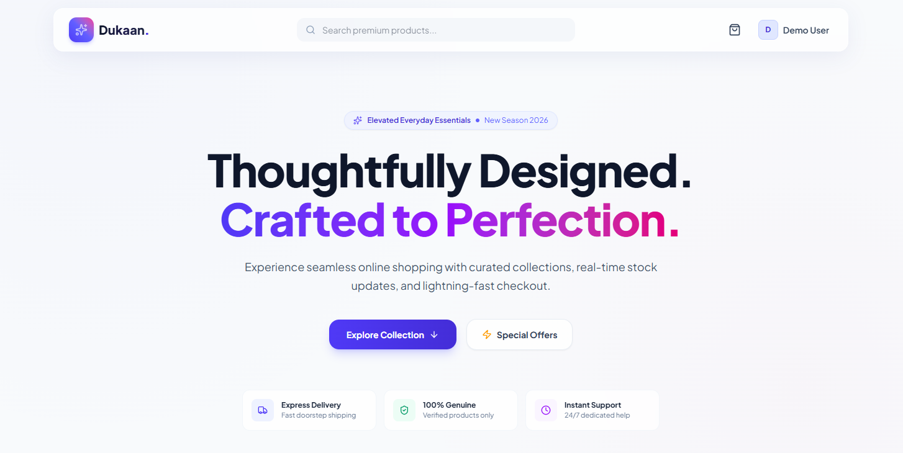

<div align="center">

# 🛍️ Dukaan — Modern Full-Stack E-Commerce Store

**A production-ready, performant, and beautifully designed full-stack e-commerce application.**  
Built for the **CodeAlpha Full-Stack Web Development Internship (Task 1: Simple E-Commerce Store)**.

---

[](https://vuejs.org/)
[](https://vitejs.dev/)
[](https://tailwindcss.com/)
[](https://nodejs.org/)
[](https://expressjs.com/)
[](https://www.mongodb.com/)
[](LICENSE)

</div>

---

## 📌 Project Overview

**Dukaan** is an end-to-end full-stack e-commerce web platform engineered with modern web standards, an ultra-clean glassmorphic UI, and a resilient, scalable backend. It bridges high aesthetic standards with enterprise-level patterns like **MongoDB ACID Transactions**, **JWT authentication**, **granular inventory management**, and **dynamic order state tracking**.

Developed as part of the **CodeAlpha Full Stack Development Internship program**, this project fulfills and exceeds all requirements for **Task 1: Simple E-Commerce Store**.

---

## 📸 Application Preview

<div align="center">
  
</div>

---

## 🚀 Key Features

### 🛒 E-Commerce Experience

- **Live Product Catalog:** Dynamic grid view with instant filtering across 8 distinct categories.
- **Instant Search & Sorting:** Real-time search by keywords and multi-criteria sorting (Price: Low to High, Price: High to Low, Name A-Z).
- **Detailed Product Pages:** High-resolution product images, live stock indicators (In Stock, Low Stock, Out of Stock), quantity selectors, and instant Add-to-Cart.
- **Interactive Cart Drawer:** Slide-over cart drawer with quantity adjustments, item deletion, live subtotal computation, and auto-open feedback.
- **2-Step Streamlined Checkout:** Intuitive shipping address capture followed by payment method selection (Cash on Delivery & Sandbox Card payment).
- **Visual Order Tracking:** Live order timeline tracker (`Pending` ➔ `Processing` ➔ `Shipped` ➔ `Delivered`) with complete order cancellation and automatic stock rollback.

### 🛡️ Security & Reliability

- **Stateless JWT Authentication:** Secure token-based session handling with bcrypt password hashing (12 salt rounds).
- **ACID Transactions:** Orders processed within database sessions (`session.withTransaction`) ensuring atomic stock decrements and zero overselling.
- **Strict Validation:** Request body sanitation and schema enforcement using `express-validator`.
- **Centralized Error Handling:** Uniform API response structure with graceful global error middleware.

### 📦 Developer Amenities

- **Automated Product Seeder:** Ready-to-use seeder script generating 200+ curated products with high-definition Unsplash CDN photography.
- **Pre-configured Demo Account:** One-click pre-filled demo credentials on the login screen for rapid evaluation.

---

## 🛠️ Technology Stack

| Layer                      | Technologies Used                                                                                         |
| :------------------------- | :-------------------------------------------------------------------------------------------------------- |
| **Frontend Framework**     | [Vue 3](https://vuejs.org/) (Composition API, `<script setup>`)                                           |
| **Build Tool**             | [Vite 8](https://vitejs.dev/)                                                                             |
| **Styling & Icons**        | [Tailwind CSS v4](https://tailwindcss.com/), [Lucide Vue Next](https://lucide.dev/)                       |
| **Client Routing & State** | [Vue Router 4](https://router.vuejs.org/), Custom Reactive Composables (`useAuth`, `useCart`, `useToast`) |
| **Backend Runtime**        | [Node.js](https://nodejs.org/) (v20+)                                                                     |
| **Backend Framework**      | [Express.js 5](https://expressjs.com/)                                                                    |
| **Database & ODM**         | [MongoDB Atlas](https://www.mongodb.com/atlas), [Mongoose 9](https://mongoosejs.com/)                     |
| **Authentication**         | [JSON Web Tokens (JWT)](https://jwt.io/), [bcryptjs](https://www.npmjs.com/package/bcryptjs)              |
| **Validation**             | [express-validator](https://express-validator.github.io/)                                                 |

---

## 📂 Project Architecture

```plaintext
CodeAlpha_Dukaan/
├── client/                     # Frontend Application (Vue 3 + Vite)
│   ├── public/                 # Static assets & favicon
│   │   ├── dashboard.PNG       # Store showcase preview
│   │   └── favicon.svg         # Dukaan brand favicon
│   ├── src/
│   │   ├── components/         # Reusable UI components (Navbar, CartDrawer, FilterBar, etc.)
│   │   ├── composables/        # Shared reactive state (useAuth, useCart, useToast)
│   │   ├── layouts/            # Base layouts (MainLayout)
│   │   ├── pages/              # View routes (HomePage, ProductDetailPage, CheckoutPage, OrdersPage, etc.)
│   │   ├── router/             # Vue Router configuration & dynamic title handling
│   │   ├── services/           # Axios/Fetch API client wrappers
│   │   ├── App.vue             # Root component
│   │   └── main.js             # Application entrypoint
│   ├── .env.example            # Sample client environment configuration
│   ├── package.json
│   └── vite.config.js
│
├── server/                     # Backend API (Express + MongoDB)
│   ├── config/                 # Database connection (db.js)
│   ├── controllers/            # Request handlers (auth, cart, order, product)
│   ├── database/seeders/       # Database seeder scripts (productSeeder.js)
│   ├── middleware/             # Auth, role-based admin, & validation middlewares
│   ├── models/                 # Mongoose schemas (User, Product, Cart, Order)
│   ├── routes/                 # Express route definitions
│   ├── services/               # Business logic & transaction handlers
│   ├── validators/             # express-validator rule chains
│   ├── .env.example            # Sample server environment configuration
│   ├── index.js                # Server entrypoint
│   └── package.json
│
└── README.md                   # Project documentation
```

---

## 🔌 API Endpoints Reference

### 🔐 Authentication (`/api/auth`)

| Method | Endpoint             | Description                      | Auth Required |
| :----- | :------------------- | :------------------------------- | :-----------: |
| `POST` | `/api/auth/register` | Register new user account        |     ❌ No     |
| `POST` | `/api/auth/login`    | Authenticate user & return JWT   |     ❌ No     |
| `GET`  | `/api/auth/me`       | Fetch authenticated user profile |    ✅ Yes     |

### 🏷️ Products (`/api/products`)

| Method | Endpoint            | Description                                   | Auth Required |
| :----- | :------------------ | :-------------------------------------------- | :-----------: |
| `GET`  | `/api/products`     | Fetch paginated products with filter & search |     ❌ No     |
| `GET`  | `/api/products/:id` | Fetch single product details by ID            |     ❌ No     |
| `POST` | `/api/products`     | Create a new product                          |   ✅ Admin    |

### 🛍️ Cart Management (`/api/cart`)

| Method   | Endpoint                    | Description                    | Auth Required |
| :------- | :-------------------------- | :----------------------------- | :-----------: |
| `GET`    | `/api/cart`                 | Get current user's active cart |    ✅ Yes     |
| `POST`   | `/api/cart`                 | Add product to cart            |    ✅ Yes     |
| `PUT`    | `/api/cart/item/:productId` | Update item quantity           |    ✅ Yes     |
| `DELETE` | `/api/cart/item/:productId` | Remove item from cart          |    ✅ Yes     |

### 📦 Orders (`/api/orders`)

| Method  | Endpoint                      | Description                               | Auth Required |
| :------ | :---------------------------- | :---------------------------------------- | :-----------: |
| `POST`  | `/api/orders`                 | Place order (initiates stock transaction) |    ✅ Yes     |
| `GET`   | `/api/orders/my-orders`       | Fetch logged-in user's order history      |    ✅ Yes     |
| `GET`   | `/api/orders/:orderId`        | Fetch single order details                |    ✅ Yes     |
| `PATCH` | `/api/orders/:orderId/cancel` | Cancel pending order (rolls back stock)   |    ✅ Yes     |
| `PATCH` | `/api/orders/:orderId/status` | Update order status                       |   ✅ Admin    |

---

## ⚡ Quick Start & Installation

### Prerequisites

- [Node.js](https://nodejs.org/) (v18.x or v20+ recommended)
- [MongoDB](https://www.mongodb.com/) (Local instance or MongoDB Atlas URI)
- [Git](https://git-scm.com/)

---

### Step 1: Clone the Repository

```bash
git clone https://github.com/imtiazaly/CodeAlpha_Dukaan.git
cd CodeAlpha_Dukaan
```

---

### Step 2: Backend Configuration & Startup

1. Open the server directory:
   ```bash
   cd server
   ```
2. Install dependencies:
   ```bash
   npm install
   ```
3. Configure environment variables:
   - Copy `.env.example` to `.env`:
     ```bash
     cp .env.example .env
     ```
   - Populate your MongoDB connection URI and JWT secret:
     ```env
     PORT=5000
     MONGODB_URI=your_mongodb_connection_string
     JWT_SECRET=your_jwt_secret_key
     JWT_EXPIRES_IN=7d
     ```
4. _(Optional but Recommended)_ Seed sample products:
   ```bash
   npm run db:seed
   ```
5. Launch the backend server:
   ```bash
   npm run dev
   ```
   _Server will run at `http://localhost:5000`._

---

### Step 3: Frontend Configuration & Startup

1. Open a new terminal and navigate to the client folder:
   ```bash
   cd client
   ```
2. Install dependencies:
   ```bash
   npm install
   ```
3. Configure client environment:
   - Copy `.env.example` to `.env`:
     ```bash
     cp .env.example .env
     ```
   - Ensure `VITE_API_BASE_URL` points to your backend:
     ```env
     VITE_API_BASE_URL=http://localhost:5000/api
     ```
4. Start the Vite dev server:
   ```bash
   npm run dev
   ```
   _Client will run at `http://localhost:5173`._

---

## 🔑 Demo Credentials

To test the application instantly without manual sign-up, use the pre-configured credentials:

| Field        | Demo Credential |
| :----------- | :-------------- |
| **Email**    | `demo@user.com` |
| **Password** | `12345678`      |

_(You can also register a brand new account directly from the UI)._

---

## 📜 CodeAlpha Internship Verification

This repository is submitted as part of the **CodeAlpha Full Stack Development Internship**.

- **Task:** Task 1 — Simple E-commerce Store
- **Domain:** Full Stack Web Development
- **Criteria Met:** All mandatory and bonus requirements (Listings, Cart, Details, Order Processing, Auth, Responsive UI, Database transactions).

---

## 👨‍💻 Author

**Imtiaz Ali**

- Full Stack Web Developer & Software Engineer
- **Email:** [imtiazali17314@gmail.com](mailto:imtiazali17314@gmail.com)
- **GitHub:** [@imtiazali](https://github.com/)

---

## 📄 License

This project is licensed under the [ISC License](LICENSE).
